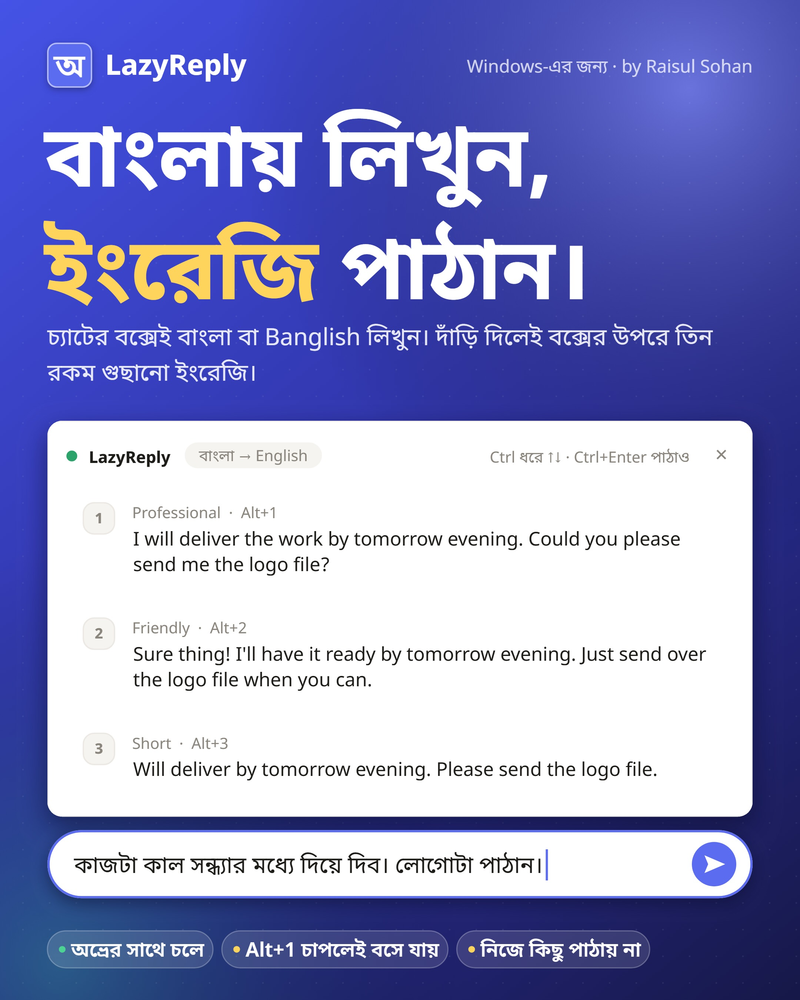

<div align="center">

# LazyReply

**চ্যাটের বক্সেই বাংলা বা Banglish-এ লিখুন, বক্সের উপরে গুছানো ইংরেজি পান।**

বাংলাদেশি ফ্রিল্যান্সারদের জন্য Windows-এর ছোট একটা অ্যাপ। অভ্রের সাথে একসাথে চলে।

[Read in English](README.md) · [ডাউনলোড](https://github.com/raisulsohan/LazyReply/releases/latest) · [নিজে build করা](#নিজে-build-করা)



</div>

## কী করে

চ্যাটের লেখার বক্সেই বাংলায় বা Banglish-এ লিখুন। বাক্য শেষ হলে বক্সের ঠিক উপরে তিন রকম ইংরেজি আসে:

| ধরন | কেমন |
|---|---|
| **Professional** | ভদ্র আর পরিষ্কার, ক্লায়েন্টের জন্য ঠিক |
| **Friendly** | আন্তরিক আর সহজ, তবু সম্মানের সাথে |
| **Short** | সবচেয়ে ছোট স্বাভাবিক রূপ, সাধারণত এক বাক্যে |

`Alt+1`, `Alt+2` বা `Alt+3` চাপলে বক্সের লেখা ওই ইংরেজি দিয়ে বদলে যায়। দেখে নিয়ে নিজে `Enter` চেপে পাঠান। **LazyReply নিজে থেকে কিছু পাঠায় না।**



## যা লাগবে

- Windows 10 বা 11।
- ইন্টারনেট সংযোগ।
- নিচের চারটে AI পথের যেকোনো একটা। সেটিংসের "AI সার্ভিস"-এ বাছাই করুন:

| পথ | কী লাগে | গতি | খরচ |
|---|---|---|---|
| Claude: আমার অ্যাকাউন্ট | Claude Code-এ login (Pro/Max প্ল্যান) | প্রথম বাক্য প্রায় ১.৪ সেকেন্ডে (পেছনে দুটো Claude Code প্রস্তুত থাকে; একই লেখা আবার এলে সাথে সাথে) | প্ল্যানের সীমা থেকে, Claude Code-এর সাথে ভাগ হয় |
| Claude: API key | https://console.anthropic.com থেকে key, আগে credit কিনতে হয় | সবচেয়ে দ্রুত | প্রতি মেসেজে খুব কম |
| Gemini: API key | https://aistudio.google.com/apikey থেকে key | দ্রুত | ফ্রি স্তর আছে, দিনের সীমা আছে |
| অন্য AI: API | OpenAI-র মতো API আছে এমন যেকোনো সার্ভিসের ঠিকানা, key আর মডেলের নাম | সার্ভিস আর মডেলের উপর নির্ভর করে | সার্ভিসের নিজের দাম; কম্পিউটারে চালানো মডেল ফ্রি |

Gemini-কে Google অ্যাকাউন্ট দিয়ে (key ছাড়া) চালানোর পথ নেই। Google ব্যক্তিগত অ্যাকাউন্টের জন্য Gemini CLI-র login বন্ধ করে দিয়েছে।

### অন্য AI: যেভাবে যোগ করবেন

1. সেটিংসে "অন্য AI · API" বাছাই করুন।
2. "সার্ভারের ঠিকানা"-র পাশে "বাছুন" চাপুন, আর সার্ভিস বাছাই করুন। তালিকায় না থাকলে সার্ভিসের দেওয়া ঠিকানা নিজে লিখুন।
3. API key দিন। Ollama বা LM Studio-তে key লাগে না।
4. "পরীক্ষা করুন" চাপুন। সার্ভিসের মডেলের তালিকা "মডেল"-এর "বাছুন"-এ আসবে।
5. একটা মডেল বাছাই করুন, আবার "পরীক্ষা করুন" চাপুন, তারপর "সেভ করুন"।

| সার্ভিস | ঠিকানা | key |
|---|---|---|
| OpenAI (ChatGPT-র মডেল) | `https://api.openai.com/v1` | https://platform.openai.com/api-keys |
| OpenRouter (অনেক কোম্পানির মডেল এক key-তে) | `https://openrouter.ai/api/v1` | https://openrouter.ai/keys |
| Groq | `https://api.groq.com/openai/v1` | https://console.groq.com/keys |
| DeepSeek | `https://api.deepseek.com/v1` | https://platform.deepseek.com/api_keys |
| Ollama (এই কম্পিউটারে) | `http://localhost:11434/v1` | লাগে না |
| LM Studio (এই কম্পিউটারে) | `http://localhost:1234/v1` | লাগে না |

- ChatGPT Plus-এর মাসিক প্ল্যানে API নেই। OpenAI-র API-র জন্য platform.openai.com-এ আলাদা credit কিনতে হয়।
- এই পথে শুধু একটা key-র ঘর আছে। অন্য সার্ভিসে গেলে সেই সার্ভিসের key দিন।
- সব সার্ভিস সব উত্তরের ধরন বোঝে না। অ্যাপ নিজে প্রথমে JSON schema, তারপর সাধারণ JSON, তারপর সাধারণ লেখা চেষ্টা করে।

## শুরু করা

1. [সর্বশেষ release](https://github.com/raisulsohan/LazyReply/releases/latest) থেকে `LazyReply.exe` ডাউনলোড করুন। কোনো installer নেই, একটাই ফাইল।
2. `LazyReply.exe` চালান। টাস্কবারের ডান কোণে নীল "অ" আইকন আসবে।
   ফাইলটায় code signing নেই, তাই Windows SmartScreen সতর্ক করতে পারে। তখন "More info", তারপর "Run anyway" চাপুন। অথবা [নিজে build করুন](#নিজে-build-করা)।
3. "অ" আইকনে ডান-ক্লিক করে "সেটিংস…" খুলুন।
4. "AI সার্ভিস" বাছাই করুন। API key পথ হলে key দিন। Claude অ্যাকাউন্ট পথে Claude Code-এ login করা থাকলেই চলবে।
5. "পরীক্ষা করুন" চাপুন। একটা নমুনা ইংরেজি বাক্য এলে সব ঠিক আছে।
6. "সেভ করুন" চাপুন।
7. প্রতিবার Windows চালু হলে চালাতে চাইলে "Windows চালু হলে নিজে চালু" চালু করুন।

ঐচ্ছিক: সেটিংসের "আপনার পরিচয়"-এ ইংরেজিতে নিজের কাজের কথা এক লাইনে লিখুন, যেমন: I am a video editor and motion designer। এতে শব্দ বাছাই ভালো হয়।

## ব্যবহার: চ্যাটের বক্সেই

1. চ্যাটের লেখার বক্সে ক্লিক করুন।
2. `Ctrl+Space` (অথবা আপনার অভ্রের কী) চাপুন। অভ্রের ভাষা বদলাবে, আর একই সাথে বক্সের ঠিক উপরে অনুবাদের বাক্স খুলবে।
3. চ্যাটের বক্সেই বাংলায় বা Banglish-এ লিখুন।
4. দাঁড়ি (`।` বা `.`), প্রশ্নবোধক (`?`) বা বিস্ময়বোধক (`!`) দিলে অনুবাদের বাক্সে সাথে সাথে তিন রকম ইংরেজি আসবে: Professional, Friendly, Short। দাঁড়ি ছাড়া মেসেজে (যেমন "ok bhai") ৩ সেকেন্ড কিছু না লিখলে আসে। বাক্যের মাঝে ছোট বিরতিতে অনুবাদ শুরু হয় না।
5. `Alt+1`, `Alt+2` বা `Alt+3` চাপুন, অথবা লাইনটায় ক্লিক করুন। বক্সের লেখা ইংরেজি দিয়ে বদলে যাবে।
6. দেখে নিয়ে নিজে `Enter` চেপে পাঠান। LazyReply নিজে থেকে কিছু পাঠায় না।

- Ctrl ধরে রেখে `↓` / `↑` চাপুন: প্রতিটা চাপে পরের বা আগের বাক্যটা চ্যাটের বক্সে বসে, আর বাক্সে সেটা নীল দাগে দেখায়। পছন্দের বাক্যে থেমে Ctrl ধরা অবস্থাতেই `Enter` চাপুন (`Ctrl+Enter`): মেসেজ চলে যায়। Ctrl ছেড়ে সাধারণ `Enter` চাপলেও যায়। বাছাই না করে `Ctrl+Enter` চাপলে প্রথম বাক্যটা (Professional) যায়। সাজেশন না থাকলে, বা আপনি বক্সের লেখা বদলালে, এই কী আগের মতো চ্যাট অ্যাপের নিজের কাজ করে।
- আবার `Ctrl+Space` চেপে ইংরেজিতে ফিরলে বাক্স নিজে বন্ধ হয়। উল্টো অনুবাদ চালু থাকলে খোলা থাকে, কারণ তখন ইংরেজি লেখারও বাংলা দরকার। যেকোনো সময় বাক্সের "×" চেপেও বন্ধ করা যায়।
- উল্টো অনুবাদ (শুরুতে বন্ধ): সেটিংসে "ইংরেজি লিখলে বাংলা অনুবাদ" চালু করুন। তখন চ্যাটের বক্সে ইংরেজি থাকলে চতুর্থ লাইনে বাংলা অনুবাদ আসে, আর `Alt+4` চাপলে সেটা বক্সে বসে। Banglish বা বাংলা লেখায় এই লাইন আসে না।
- অন্য অ্যাপে গেলে বাক্সটা সরে যায়। সেখানে লিখতে শুরু করলে সেই চ্যাট বক্সের উপরে আবার আসে।
- ট্রে-র "অ" আইকনে একবার ক্লিক করলে LazyReply বিরতিতে যায়। বাক্স বন্ধ হয়, আইকন ধূসর হয়, আর কোনো কী চাপলেও বাক্স খোলে না। আবার ক্লিক করলে LazyReply চালু হয়, আর চ্যাটে বাক্স খোলে।

## ব্যবহার: আলাদা উইন্ডো

বড় লেখা, উল্টো অনুবাদ বা প্রসঙ্গ দিতে চাইলে `Ctrl+Shift+E` চাপুন। আলাদা অনুবাদকের উইন্ডো খুলবে।

| কী | কাজ |
|---|---|
| `Enter` | বাছাই করা বাক্য চ্যাটে বসাও |
| `Shift+Enter` | নতুন লাইন |
| `Ctrl+1` / `Ctrl+2` / `Ctrl+3` | ওই নম্বরের বাক্য সরাসরি বসাও |
| `Ctrl+↑` / `Ctrl+↓` | বাক্য বাছাই |
| `Ctrl+Shift+C` | বাছাই করা বাক্য কপি |
| `Ctrl+R` | উল্টো অনুবাদ: ক্লায়েন্টের ইংরেজি → বাংলা মানে |
| `Ctrl+K` | প্রসঙ্গ: ক্লায়েন্টের শেষ মেসেজ দিন, উত্তর সেই কথার সাথে মিলবে |
| `Esc` | বন্ধ করো, চ্যাটে ফিরে যাও |

## অনুবাদের বাক্স খোলার কী

শুরুতে LazyReply অভ্রের নিজের মোড বদলের কী ব্যবহার করে। কীটা অভ্রের সেটিংস থেকে পড়া হয় (যেমন `Ctrl+Space` বা `F12`)। অভ্রে কী বদলালে কয়েক সেকেন্ডের মধ্যে এখানেও বদলায়।

অভ্র না থাকলে (Windows-এর বাংলা কিবোর্ড, Bijoy ইত্যাদি), বা অন্য কী চাইলে: সেটিংস → "অনুবাদের বাক্স খোলার কী" → "নিজের কী" বাছাই করুন, আর কী লিখুন (যেমন `Ctrl+Alt+T`, `F9`, `Win+Space`)। নিজের কী চ্যাট অ্যাপের কাছেও যায়, তাই ওই কী-র আগের কাজও চলতে থাকে।

## শর্টকাট চাপলে কী হবে

"অ" আইকনে ডান-ক্লিক করুন → "শর্টকাট চাপলে"। সেটিংসেও একই অপশন আছে:

- **অনুবাদের বাক্স খোলো** (শুরুতে এটাই): প্রতিবার কী চাপলে বাক্স খোলে।
- **আগে ছোট টিপে জিজ্ঞেস করো:** একটা টিপ আসে। "চালু করুন" বা `Alt+Y` চাপলে বাক্স খোলে। টিপের "×" চাপলে টিপ আর আসে না।
- **কিছু করো না:** কী চাপলে বাক্স খোলে না। বাক্স খুলতে ট্রে আইকনে ডান-ক্লিক → "অনুবাদের বাক্স"।

## অভ্রের মোড কীভাবে বোঝে

- অভ্রের নিজের সেটিংস থেকে মোড বদলের কী পড়ে (সাধারণত `Ctrl+Space`)। অভ্রে কী বদলালে এটাও নিজে বদলায়।
- বাংলা মোডে অভ্র প্রতিটা অক্ষর নিজে টাইপ করে। LazyReply সেটা দেখে মোড মিলিয়ে নেয়। তাই মাউস দিয়ে অভ্রের মোড বদলালেও প্রথম অক্ষর লেখার পর আবার ঠিক হয়ে যায়।
- আইকনের রং: নীল = অভ্র English, সবুজ = অভ্র বাংলা।

## জানা সীমা

- Administrator হিসেবে চলা কোনো অ্যাপে Windows লেখা বসাতে দেয় না। তখন আলাদা উইন্ডোর `Ctrl+Shift+C` দিয়ে কপি করে নিজে পেস্ট করুন।
- লেখা বসানোর সময় clipboard ব্যবহার হয়। আগের clipboard-এর লেখা বা ছবি এক সেকেন্ডের মধ্যে ফিরিয়ে দেওয়া হয়।
- চ্যাটের বক্সে অনুবাদ বক্সের পুরো লেখাটা বদলায়। বক্সে আগে থেকে অন্য লেখা থাকলে সেটাও অনুবাদে ঢোকে।
- Gemini-র ফ্রি স্তরে শুধু "flash" মডেলগুলো চলে। অন্য মডেল বাছাই করলে অ্যাপ নিজে একটা ফ্রি Flash মডেলে যায় আর সেটা সেভ করে।
- Gemini-র ফ্রি সার্ভার মাঝে মাঝে ব্যস্ত থাকে, বা একটা মডেলের দিনের সীমা শেষ হয়। তখন অ্যাপ পরের ফ্রি Flash মডেলে যায়। এতে কখনো ২০–৩০ সেকেন্ড লাগতে পারে।

## গোপনীয়তা

- চ্যাটের বক্সের লেখা শুধু অনুবাদ চালু থাকলে পড়া হয়, আর শুধু ফোকাস করা লেখার বক্সটা। পাসওয়ার্ড বক্স কখনো পড়া হয় না।
- API key Windows-এর DPAPI দিয়ে এনক্রিপ্ট করে রাখা হয়। শুধু আপনার Windows অ্যাকাউন্ট এটা পড়তে পারে।
- সেটিংস আর লগ থাকে `%APPDATA%\LazyReply`-তে। লগে আপনার লেখা থাকে না।
- আপনার লেখা শুধু আপনার বাছাই করা AI সার্ভিসে (Anthropic, Google, অথবা "অন্য AI"-এ দেওয়া ঠিকানায়) যায়। Google-এর ফ্রি স্তরে Google লেখাটা তাদের সেবা উন্নত করতে ব্যবহার করতে পারে। অন্য সার্ভিস লেখা কীভাবে ব্যবহার করে, তা সেই সার্ভিসের নিয়ম দেখুন।
- Ollama বা LM Studio-র মতো এই কম্পিউটারের সার্ভারে লেখা কম্পিউটারের বাইরে যায় না।
- Claude অ্যাকাউন্ট পথে Claude Code `--safe-mode` আর সব টুল বন্ধ রেখে চলে: আপনার `CLAUDE.md`, hook বা অন্য টুল অনুবাদে ঢোকে না।

## নিজে build করা

আলাদা কিছু install করতে হয় না। এটা Windows-এর নিজের C# compiler (.NET Framework 4.x) ব্যবহার করে:

```powershell
powershell -ExecutionPolicy Bypass -File build.ps1
```

`LazyReply.exe` আর তার আইকন `app.ico` তৈরি হয় `build.ps1`-এর পাশে। LazyReply চালু থাকলে আগে বন্ধ করুন ("অ" আইকনে ডান-ক্লিক → "LazyReply বন্ধ করুন"), নইলে build ফাইলটা বদলাতে পারে না।

ফোল্ডারের গঠন আর প্রতিটা ফাইলের কাজ [English README-তে](README.md#build-from-source) আছে।

## About

Created by [Raisul Sohan](https://raisulsohan.com/en/portfolio).

অ্যাপের ভেতরে: "অ" আইকনে ডান-ক্লিক → "About LazyReply", অথবা সেটিংসের নিচে "About"। নামে ক্লিক করলে পোর্টফোলিও খোলে।

License: [MIT](LICENSE)
