<div align="center">

# LazyReply

**Type Bangla or Banglish in any chat box. Get clean English just above it.**

A small Windows tray app for Bangladeshi freelancers. Works with Avro.

[বাংলায় পড়ুন](README.bn.md) · [Download](https://github.com/raisulsohan/LazyReply/releases/latest) · [Build from source](#build-from-source)




</div>

## What it does

You write to your client in Bangla (বাংলা) or Banglish, right in the chat box of any app (chat boxes in the browser included). When the sentence ends, LazyReply shows three English versions in a small box just above the chat box:

| Version | Tone |
|---|---|
| **Professional** | polite and clear, right for a client |
| **Friendly** | warm and relaxed, still respectful |
| **Short** | the shortest natural version, usually one sentence |

Press `Alt+1`, `Alt+2` or `Alt+3` (or click a line) and your text in the chat box changes to that English version. Read it, then press `Enter` yourself. **LazyReply never sends anything by itself.**

## Features

- **Works in the chat box itself.** No copy and paste. The box floats above the chat box and never takes the keyboard focus, so you keep typing.
- **Starts at the end of a sentence.** Translation starts when you type `।`, `.`, `?` or `!`. A message with no full stop (for example "ok bhai") is translated after 3 seconds without typing. Short pauses inside a sentence do not start it.
- **Choose with the keyboard.** Hold `Ctrl` and press `↓` / `↑`: each press puts the next or previous version in the chat box, and a blue highlight glides to it. Press `Enter` while you still hold `Ctrl` (`Ctrl+Enter`) to send it.
- **Works with Avro.** LazyReply reads Avro's own switch key (for example `Ctrl+Space`) from Avro's settings and follows Avro's English/Bangla mode. When Avro goes to Bangla, the box opens. When you go back to English, it closes.
- **No Avro?** Set your own key in Settings (for example `Ctrl+Alt+T`, `F9`, `Win+Space`). This works with the Windows Bangla keyboard, Bijoy and others.
- **Reverse translation (optional).** Turn on "ইংরেজি লিখলে বাংলা অনুবাদ" in Settings. English text in the chat box then also gets a Bangla translation on a fourth line (`Alt+4`).
- **Separate translator window** (`Ctrl+Shift+E`) for long text, for the client's message in Bangla (`Ctrl+R`), or to give the client's last message as context (`Ctrl+K`).
- **About you (optional).** Write one line about your work in Settings, for example "I am a video editor and motion designer". It helps the AI choose the right words.
- **Four AI options:** your Claude account, a Claude API key, a Gemini API key, or any service with an OpenAI-compatible API (OpenAI, OpenRouter, Groq, DeepSeek, Ollama, LM Studio).
- **Light and dark** colours follow the Windows app setting.

## Download and start

1. Download `LazyReply.exe` from the [latest release](https://github.com/raisulsohan/LazyReply/releases/latest). There is no installer: it is one file.
2. Run it. A blue **অ** icon appears in the notification area (the right corner of the taskbar).
   Windows SmartScreen may warn you, because the file is not code-signed. Click "More info", then "Run anyway". Or [build it yourself](#build-from-source) from this source.
3. Right-click the **অ** icon and open "সেটিংস…" (Settings).
4. Choose an AI service (see below). For an API key option, enter the key.
5. Click "পরীক্ষা করুন" (Test). A sample English sentence means everything works.
6. Click "সেভ করুন" (Save).
7. To start LazyReply with Windows, turn on "Windows চালু হলে নিজে চালু".

**Needs:** Windows 10 or 11, an internet connection (not for a model on your own computer), and one of the four AI options. The app interface is in Bangla.

## AI options

| Option | What you need | Speed | Cost |
|---|---|---|---|
| **Claude: my account** | Claude Code installed and signed in (Pro/Max plan) | first sentence in about 1.4 s (two Claude Code processes wait ready; the same text again comes back at once) | from your plan's limits, shared with Claude Code |
| **Claude: API key** | a key from [console.anthropic.com](https://console.anthropic.com) (buy credit first) | fastest | very little per message |
| **Gemini: API key** | a key from [aistudio.google.com/apikey](https://aistudio.google.com/apikey) | fast | has a free tier with daily limits |
| **অন্য AI · API** (other AI) | the address, key and model name of any service with an OpenAI-compatible API | depends on the service and model | the service's own price; a model on your computer is free |

There is no way to use Gemini with a Google account and no key: Google ended Gemini CLI sign-in for personal accounts.

### Other AI: how to add one

1. In Settings, choose "অন্য AI · API".
2. Next to "সার্ভারের ঠিকানা" (server address), click "বাছুন" (choose) and pick a service. If it is not in the list, type the address the service gives you.
3. Enter the API key. Ollama and LM Studio need no key.
4. Click "পরীক্ষা করুন" (Test). The service's models then appear in "বাছুন" next to "মডেল" (model).
5. Choose a model, click "পরীক্ষা করুন" again, then "সেভ করুন".

| Service | Address | Key |
|---|---|---|
| OpenAI (the ChatGPT models) | `https://api.openai.com/v1` | [platform.openai.com/api-keys](https://platform.openai.com/api-keys) |
| OpenRouter (models of many companies, one key) | `https://openrouter.ai/api/v1` | [openrouter.ai/keys](https://openrouter.ai/keys) |
| Groq | `https://api.groq.com/openai/v1` | [console.groq.com/keys](https://console.groq.com/keys) |
| DeepSeek | `https://api.deepseek.com/v1` | [platform.deepseek.com/api_keys](https://platform.deepseek.com/api_keys) |
| Ollama (on this computer) | `http://localhost:11434/v1` | not needed |
| LM Studio (on this computer) | `http://localhost:1234/v1` | not needed |

- A ChatGPT Plus plan does not include the API. OpenAI's API needs separate credit on platform.openai.com.
- This option has one key field. When you change to another service, enter that service's key.
- Not every service knows every answer format. The app tries a JSON schema first, then plain JSON, then plain text, and keeps the one that worked.

## How to use it

### In the chat box

1. Click in the chat box.
2. Press `Ctrl+Space` (or your Avro key). Avro changes to Bangla, and the LazyReply box opens just above the chat box.
3. Type in Bangla or Banglish.
4. End the sentence with `।`, `.`, `?` or `!`. The three English versions appear.
5. Press `Alt+1`, `Alt+2` or `Alt+3`, or click a line. The chat box text changes to that version.
6. Check it, and press `Enter` yourself.

| Key | What it does |
|---|---|
| `Alt+1` / `Alt+2` / `Alt+3` | put that version in the chat box |
| `Ctrl+↓` / `Ctrl+↑` | put the next / previous version in the chat box |
| `Ctrl+Enter` | send the chosen version (with none chosen: the Professional one) |
| `Alt+4` | put the Bangla translation in the box (reverse translation on) |
| `Ctrl+Space` | back to English: the box closes (it stays open when reverse translation is on) |

- If you change the text in the chat box, these keys do their normal work in the chat app again.
- In another app, the box moves away. When you type there, it comes back above that chat box.
- A click on the tray icon pauses LazyReply: the box closes, the icon turns grey, and no key opens the box. Click the icon again to resume; the box opens in the chat at once. The "×" on the box closes it.

### The separate translator window

Press `Ctrl+Shift+E`.

| Key | What it does |
|---|---|
| `Enter` | put the chosen version in the chat |
| `Shift+Enter` | new line |
| `Ctrl+1` / `Ctrl+2` / `Ctrl+3` | put that version in directly |
| `Ctrl+↑` / `Ctrl+↓` | choose a version |
| `Ctrl+Shift+C` | copy the chosen version |
| `Ctrl+R` | reverse: the client's English → its meaning in Bangla |
| `Ctrl+K` | context: paste the client's last message, so the reply fits it |
| `Esc` | close, back to the chat |

### When the shortcut is pressed

Right-click the **অ** icon → "শর্টকাট চাপলে" (also in Settings):

- **Open the box** (default): each press opens the box.
- **Ask first with a small tip:** a tip appears. "চালু করুন" or `Alt+Y` opens the box.
- **Do nothing:** the key opens nothing. Right-click the tray icon → "অনুবাদের বাক্স" to open the box.

The icon colour shows Avro's mode: **blue** = English, **green** = Bangla. If you change Avro's mode with the mouse, LazyReply corrects itself after the first letter you type.

## Privacy

- LazyReply reads the chat box only while translation is on, and only the text box that has the focus. It never reads password boxes.
- API keys are encrypted with Windows DPAPI. Only your Windows account can read them.
- Settings and the log are in `%APPDATA%\LazyReply`. The log never contains your text.
- Your text goes only to the AI service you choose (Anthropic, Google, or the address you gave in "other AI"). On Google's free tier, Google can use the text to improve its services. For other services, read their own terms.
- With a server on your own computer (Ollama, LM Studio), your text stays on your computer.
- In "Claude: my account" mode, Claude Code runs with `--safe-mode` and no tools: your `CLAUDE.md`, hooks and other tools never take part in a translation.

## Known limits

- Windows does not let an app type into an app that runs as Administrator. There, use the translator window's `Ctrl+Shift+C` to copy, and paste yourself.
- LazyReply uses the clipboard to put text in the chat box. Your earlier clipboard text or picture comes back within one second.
- The chosen version replaces all the text in the chat box. Any other text that was in the box is part of the translation too.
- Gemini's free tier runs only the "flash" models. If you choose another model, the app moves to a free Flash model and saves it.
- Gemini's free servers are sometimes busy, or a model's daily limit runs out. The app then moves to the next free Flash model. This can take 20–30 seconds.

## Build from source

You need nothing extra. The build uses the C# compiler that comes with Windows (.NET Framework 4.x):

```powershell
powershell -ExecutionPolicy Bypass -File build.ps1
```

It writes `LazyReply.exe` (and its icon, `app.ico`) next to `build.ps1`. If LazyReply is running, close it first (right-click the **অ** icon → "LazyReply বন্ধ করুন"), or the build cannot replace the file.

```text
src/             C# source
  TrayApp.cs          tray icon and menu; connects the parts
  AvroWatcher.cs      follows Avro's English/Bangla mode and switch key
  FocusReader.cs      reads the focused text box (UI Automation)
  InlineController.cs translation in the chat box: when to start, keys, choosing
  InlinePopup.cs      the box above the chat box
  Inserter.cs         puts text in the chat box through the clipboard
  Engine.cs           the AI services (Claude, Gemini, OpenAI-compatible)
  ClaudeSession.cs    Claude Code processes for "Claude: my account"
  TranslatorPanel.cs  the separate translator window
  SettingsForm.cs     settings
  PromptToast.cs      the small tip
  Ui.cs, Native.cs, Common.cs, About.cs, Program.cs
build.ps1        builds LazyReply.exe
docs/demo.svg    the animation at the top of this page
social/          the 4:5 poster and its generator (poster.html, shoot.ps1, export.ps1)
```

## Credits

Created by [Raisul Sohan](https://raisulsohan.com/en/portfolio).

The demo animation uses [Noto Sans Bengali](https://fonts.google.com/noto/specimen/Noto+Sans+Bengali) (SIL Open Font License).

## License

[MIT](LICENSE)
